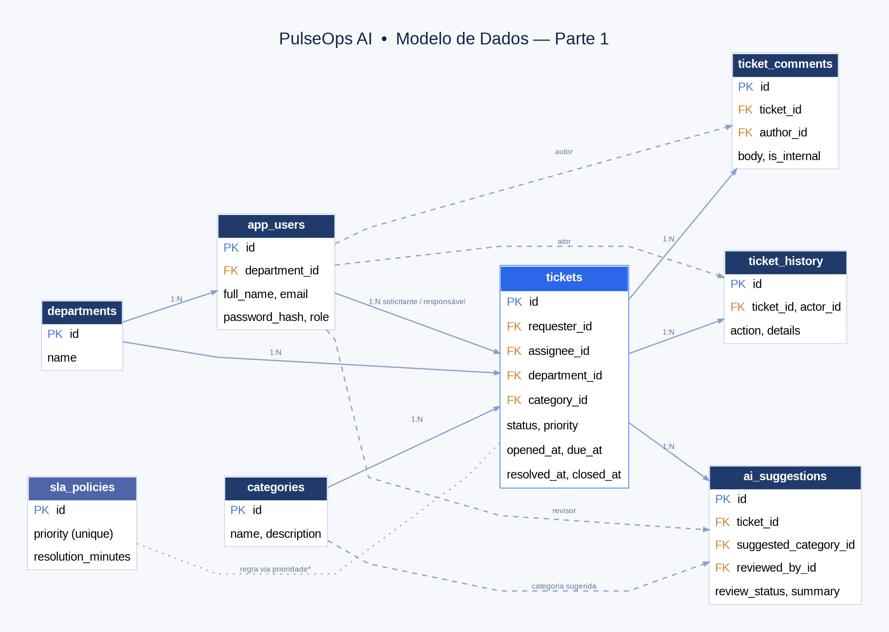

# Documentação técnica — PulseOps AI

> **Versão do MVP:** 0.3.0. **Estado:** API FastAPI, interface React e PostgreSQL implementados; execução local documentada e stack Docker preparada para validação. O deploy público e a homologação empresarial continuam pendentes.

## Objetivo

Plataforma demonstrativa de Service Desk com autenticação, tickets, atribuição, categorias, estados, comentários, histórico, SLA, indicadores e inteligência artificial sob revisão humana.

## Implementação atual

- `backend/app/`: FastAPI, endpoints REST, autorização por JWT/perfil e transações PostgreSQL.
- `frontend/src/`: dashboard React/TypeScript, chamados, Equipes, Central de IA, assistente de triagem e resolução.
- `db/init/`: oito tabelas PostgreSQL, views e seed fictícia (contas inativas por padrão).
- `compose.yaml`: PostgreSQL local com volume persistente.
- `compose.app.yaml`: stack integrada FastAPI + React/Nginx; serviço Ollama opcional.
- `backend/scripts/create_admin.py`: criação de conta administrativa por senha privada solicitada interativamente.
- `backend/tests/`, `.github/workflows/`: testes de API/segurança/banco, build TS e smoke test Docker.
- `prototype/`: referência visual estática histórica, não é a aplicação integrada.

## Arquitetura lógica

```text
Navegador
  → React (Vite / Nginx no Docker)
  → FastAPI (JWT, RBAC, regras de negócio)
  → PostgreSQL (tickets, histórico, políticas SLA, sugestões)
                      ↘
                 Ollama local ou API OpenAI (opcional)
```

O texto de um chamado é entrada não confiável. A IA apenas sugere classificação e passos de resolução. Ações executáveis são uma lista fechada do servidor: diagnóstico da própria plataforma, publicação de template de orientação e avanço controlado de status. Cada ação exige aprovação humana.

## Modelo de domínio

O banco contém `departments`, `app_users`, `categories`, `sla_policies`, `tickets`, `ticket_comments`, `ticket_history` e `ai_suggestions`. O SQL do diretório `db/init` descreve o modelo físico inicial. Migrações posteriores ficam em `db/migrations`.



## Contratos e operação

- [Contrato real da API](docs/api/contrato-api.md).
- [Triagem supervisionada](docs/funcionalidades/ia-supervisionada.md).
- [Automação e resolução](docs/funcionalidades/resolucao-assistida.md).
- [SLA e recálculo](docs/funcionalidades/sla.md).
- [Implantação e checklist](docs/implantacao/guia-de-release.md).
- [Testes](docs/testes/plano-de-testes.md).
- [Segurança e privacidade](docs/seguranca/seguranca-e-privacidade.md).
- [Índice completo](docs/00-indice.md).

## Limites

A stack tem configurações mais seguras no modo `APP_ENVIRONMENT=production` (segredo JWT mínimo, CORS restrito, Swagger desativado, cabeçalhos de segurança e limite de requisições de login via Nginx), mas **não substitui** HTTPS, monitoramento, backups, pentest, gestão de segredos e controle corporativo de identidade. Operações externas de TI não estão conectadas. Nenhuma imagem de arquitetura/protótipo comprova implantação.
