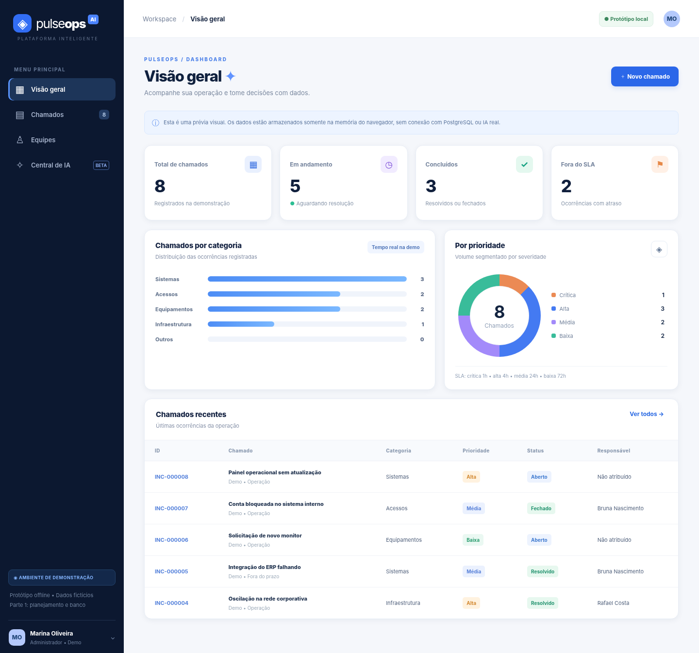
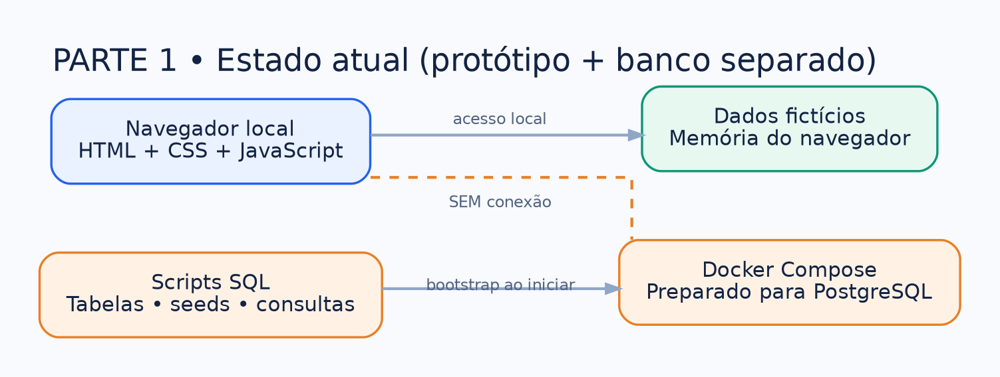
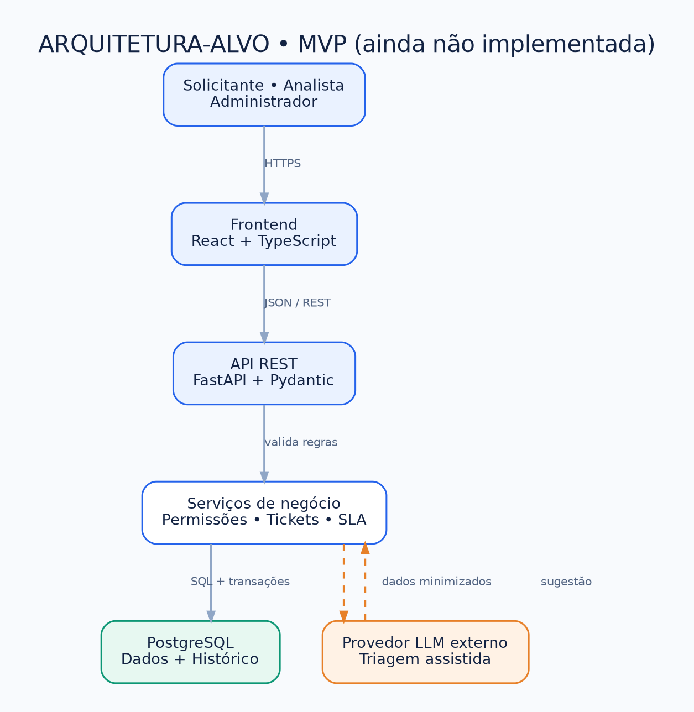

# PulseOps AI — Gestão Inteligente de Operações

Projeto de portfólio de Service Desk com React + TypeScript, FastAPI e PostgreSQL: autenticação, chamados, atribuição, histórico, SLAs, métricas e triagem assistida com revisão humana.

> **Status:** aplicação funcional em desenvolvimento. Backend, frontend, login, gestão de chamados e SLA estão implementados; a triagem assistida possui modo demonstrativo e provedor externo opcional. Ainda faltam revisão de segurança, testes manuais locais, filtros/CSV, implantação e demonstração pública. **Não é um sistema pronto para produção.**



## Documentação principal

- [Índice de toda a documentação](docs/00-indice.md) — comece aqui.
- [Planejamento](docs/planejamento/plano-geral.md) e [roadmap](docs/planejamento/roadmap-e-sprints.md).
- [Requisitos e histórias de usuário](docs/requisitos/requisitos-e-historias.md) e [regras de negócio](docs/requisitos/regras-de-negocio.md).
- [Arquitetura](docs/arquitetura/arquitetura.md), [galeria visual](docs/arquitetura/galeria-visual.md) e [diagramas PlantUML](docs/uml/README.md).
- [Modelagem do banco de dados](docs/banco-de-dados/modelagem.md) e [API planejada](docs/api/contrato-api.md).
- [Segurança](docs/seguranca/seguranca-e-privacidade.md), [testes](docs/testes/plano-de-testes.md) e [guia de commits](docs/contribuicao/git-e-commits.md).
- [SLA](docs/funcionalidades/sla.md) e [triagem supervisionada](docs/funcionalidades/ia-supervisionada.md).
- **Para IA e agentes:** [`llms.txt`](llms.txt) (mapa curto) e [`llms-full.txt`](llms-full.txt) (documentação consolidada).

## Arquitetura atual e proposta

**Aplicação:** frontend React/Vite, API FastAPI com JWT e PostgreSQL. O protótipo estático continua disponível como referência histórica.



**Triagem:** modo local de demonstração sem LLM e adaptador opcional para provedor externo, sempre com revisão humana.



## Executar a aplicação local (Mac/Linux)

Configure PostgreSQL e um usuário ativo previamente; as contas fictícias da seed vêm desativadas. Nunca execute o script de criação inicial sobre um banco com dados existentes.

No backend, crie `backend/.env` a partir do exemplo e configure `DATABASE_URL`, `JWT_SECRET_KEY` e, se necessário, as variáveis de IA:

```bash
cd backend
python3 -m venv .venv
.venv/bin/python -m pip install -r requirements.txt
.venv/bin/python -m uvicorn app.main:app --host 127.0.0.1 --port 8010
```

Em outro terminal, na pasta `frontend`:

```bash
npm ci
printf 'VITE_API_URL=http://127.0.0.1:8010\\n' > .env.local
npm run dev -- --host 127.0.0.1 --port 5173
```

Abra `http://127.0.0.1:5173`. O Swagger fica em `http://127.0.0.1:8010/docs`. O modo `AI_PROVIDER=mock` permite demonstrar triagem sem chave externa, mas **não executa um LLM**. Veja a [configuração de IA](docs/funcionalidades/ia-supervisionada.md).

## Executar protótipo no Windows

1. Extraia este projeto e abra a pasta no VS Code.
2. Abra `prototype/index.html` no navegador. A interface é demonstrativa e não salva alterações no PostgreSQL.
3. Para subir o banco local, com o Docker Desktop aberto, execute no PowerShell:

```powershell
Copy-Item .env.example .env
notepad .env
# Troque POSTGRES_PASSWORD por uma senha de desenvolvimento forte antes de prosseguir
docker compose up -d
docker compose ps
.\scripts\testar-banco.ps1
```

Para entrar no banco:

```powershell
docker compose exec database sh -c 'psql -U "$POSTGRES_USER" -d "$POSTGRES_DB"'
```

> **Atenção:** `docker compose down -v` apaga o volume do PostgreSQL. Os arquivos `db/init/*.sql` são aplicados somente na criação inicial do volume. Mudanças posteriores exigirão migrações.

## Fontes disponíveis

```text
prototype/         HTML, CSS e JavaScript da demonstração
db/init/           Esquema e dados fictícios para PostgreSQL
db/queries/        Consultas analíticas
db/tests/          Testes SQL preparados
compose.yaml       Serviço local PostgreSQL
scripts/           Verificação do banco, renderização UML e validação dos docs
docs/              Planejamento, arquitetura, UML e imagens
llms.txt           Navegação resumida para LLMs
llms-full.txt      Contexto textual consolidado
```

## Qualidade e segurança

- Não publique `.env`, credenciais ou dados reais de clientes.
- Os dados do protótipo são fictícios e não constituem autenticação ou sistema pronto para produção.
- Autenticação, autorização por perfil, auditoria e testes de API já existem; testes end-to-end em navegador e revisão de segurança para produção continuam pendentes.
- A renderização das fontes PlantUML oficiais depende de Java + JAR PlantUML no computador. As imagens existentes são prévias e não substituem a validação dessas fontes.

## Verificar a documentação

A ação [Validar documentação](.github/workflows/docs.yml) também executa essas verificações automaticamente no GitHub.

```powershell
python scripts/gerar-llms-full.py
python scripts/validar-documentacao.py
```

[Documentação técnica consolidada](DOCUMENTACAO.md) · [Guia de Git e commits](docs/contribuicao/git-e-commits.md)
