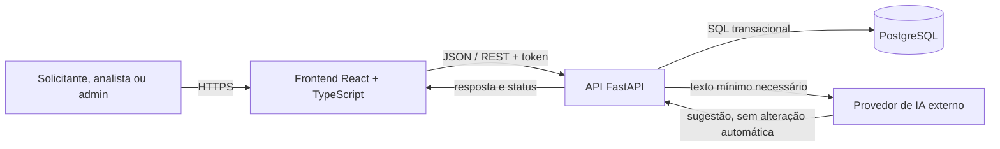
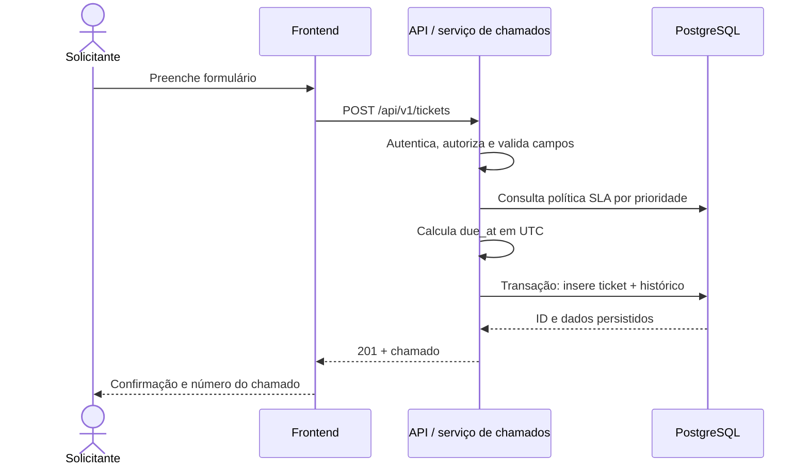
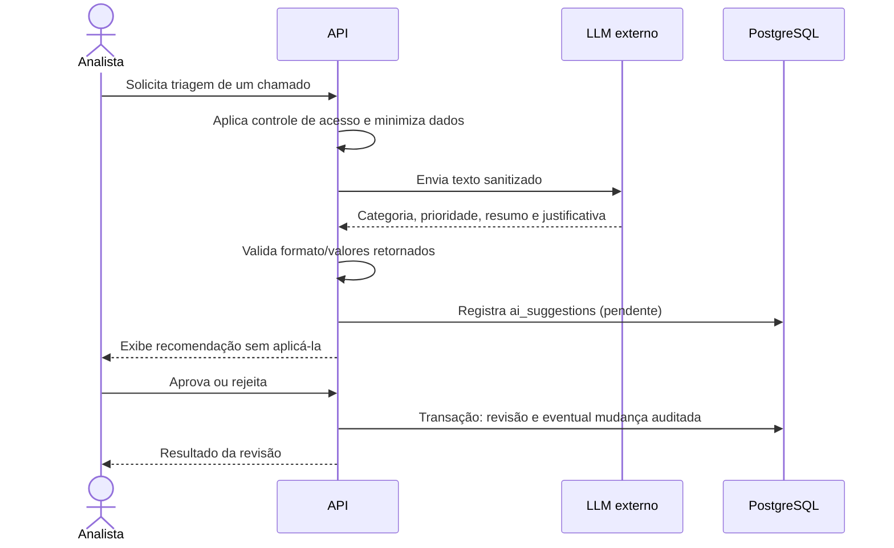
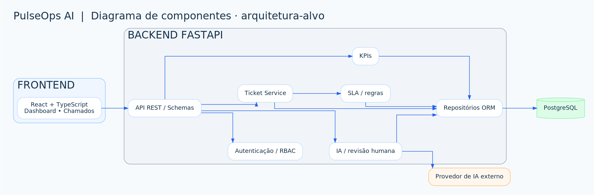

# Arquitetura de software — PulseOps AI

> **Estado da documentação:** Arquitetura-alvo planejada; a Parte 1 contém protótipo HTML/CSS/JS offline e infraestrutura SQL/Docker preparada, sem API, React ou integração de IA.

**Tipo:** monólito modular para MVP · **Status:** arquitetura-alvo proposta; back-end e integração ainda não implementados.

## 1. Contexto e restrições

O PulseOps AI centralizará chamados internos, seus responsáveis e indicadores operacionais em uma aplicação web. Prioridades: simplicidade para um portfólio individual, facilidade de teste, auditabilidade e possibilidade de evoluir sem criar microsserviços prematuramente.

**Agora:** `prototype/` roda localmente com dados fictícios, e `db/` contém scripts SQL. **Futuramente:** React consumirá uma API FastAPI que acessará PostgreSQL e, sob demanda, um provedor externo de IA.

## 2. Diagrama de contexto (arquitetura-alvo)



**Limites de confiança:** navegador não é confiável; autenticação/autorização ocorrem no servidor. O provedor de IA é um terceiro; saída do modelo é conteúdo não confiável até a validação e a revisão humana.

## 3. Camadas planejadas

| Camada | Responsabilidade | Stack proposta |
|---|---|---|
| Apresentação | Formulários, tabela, filtros, KPI, UX | React, TypeScript |
| Transporte/API | Rotas, esquemas de entrada/saída, autenticação, erros | FastAPI, Pydantic |
| Aplicação | Casos de uso: abrir, atribuir, resolver, revisar sugestão | Serviços Python |
| Domínio | Regras de status, SLA, perfis, permissões e invariantes | Funções/classes testáveis |
| Persistência | Consultas e transações, histórico, migrações | SQLAlchemy + Alembic + PostgreSQL |
| Integrações | Cliente HTTP de IA encapsulado; timeouts e configuração | Adaptador de LLM (futuro) |

### Estrutura proposta (não criada ainda)

```text
backend/
├── app/
│   ├── main.py
│   ├── api/v1/          # routers e dependências
│   ├── core/            # configurações, autenticação, permissões
│   ├── models/          # modelos ORM
│   ├── schemas/         # Pydantic request/response
│   ├── services/        # casos de uso, SLA, triagem
│   ├── repositories/    # acesso a dados
│   └── integrations/    # API de IA
├── alembic/             # migrações versionadas
└── tests/
frontend/
├── src/components/
├── src/pages/
├── src/services/        # cliente HTTP tipado
└── src/types/
```

A separação evita colocar SQL e regras de permissão diretamente nos routers. O módulo de IA pode ser substituído por simulador nos testes.

## 4. Fluxos principais (propostos)

### Abertura de chamado



### Sugestão de IA com revisão humana (Parte 5)



## 5. Persistência e consistência

- O modelo físico existente possui **8 tabelas**: `departments`, `app_users`, `categories`, `sla_policies`, `tickets`, `ticket_comments`, `ticket_history` e `ai_suggestions`.
- `opened_at`, `due_at` e datas de resolução são `TIMESTAMPTZ`; a API deverá trabalhar internamente em UTC e converter para o fuso local na apresentação.
- Criar chamado + histórico e revisão de sugestão + atualização de chamado devem ser transações atômicas.
- Índices de busca foram preparados em `db/init/01_schema.sql`. Novos índices serão adicionados com base em consultas reais, não por suposição.
- No MVP, apenas **uma empresa/instância**; isolamento multiempresa está fora do escopo.
- **Migrações com Alembic** serão adotadas na Parte 2; os scripts em `db/init/` são apenas o bootstrap de uma base nova.

## 6. Contratos e respostas

- Base sugerida: `/api/v1` (consulte [contrato detalhado](../api/contrato-api.md)).
- HTTP: `200` consulta/atualização; `201` criação; `400` ou `422` dados inválidos; `401` sem sessão; `403` sem permissão; `404` inexistente/não visível; `409` conflito de estado quando adequado.
- Listagens paginadas no servidor; nunca fornecer todos os registros por padrão.
- Retornar erros consistentes, sem stack trace ao usuário. Logs estruturados com `request_id`, sem tokens e descrições sensíveis.
- Toda rota com dados privados exige autorização no back-end, inclusive `/dashboard`.

## 7. Infraestrutura

**Desenvolvimento nesta Parte 1:** `compose.yaml` inicia apenas PostgreSQL com volume persistente e bind em `127.0.0.1`. O protótipo é arquivo estático independente.

**Objetivo para Parte 6:** contêineres de API e frontend; variáveis por ambiente; HTTPS em hospedagem; health checks; migrations no deploy; cópias de segurança e política de recuperação; CI automatizada no GitHub Actions. Nenhuma dessas operações de produção está configurada nesta entrega.

## 8. Critérios de qualidade arquitetural (metas, não medições)

- Regra de negócio coberta por testes unitários; rotas críticas cobertas por integração.
- Dados internos jamais retornados a perfis sem acesso.
- API documentada via OpenAPI e comportamento consistente com a implementação.
- Configuração por ambiente, sem chaves de API no repositório.
- A aplicação deve seguir funcional quando a IA estiver indisponível: sugerir manualmente, registrar erro operacional e permitir atendimento humano.

**Decisões e alternativas:** [12-riscos-e-decisoes.md](../planejamento/riscos-e-decisoes.md).

## UML editável: estrutura e comportamento

As propostas de arquitetura e integração também foram documentadas como **PlantUML**, com prévias visuais:




Veja [todos os diagramas UML e as fontes `.puml`](../uml/README.md). A implantação e as sequências apresentadas são propostas para as próximas etapas, não recursos executados nesta Parte 1.
