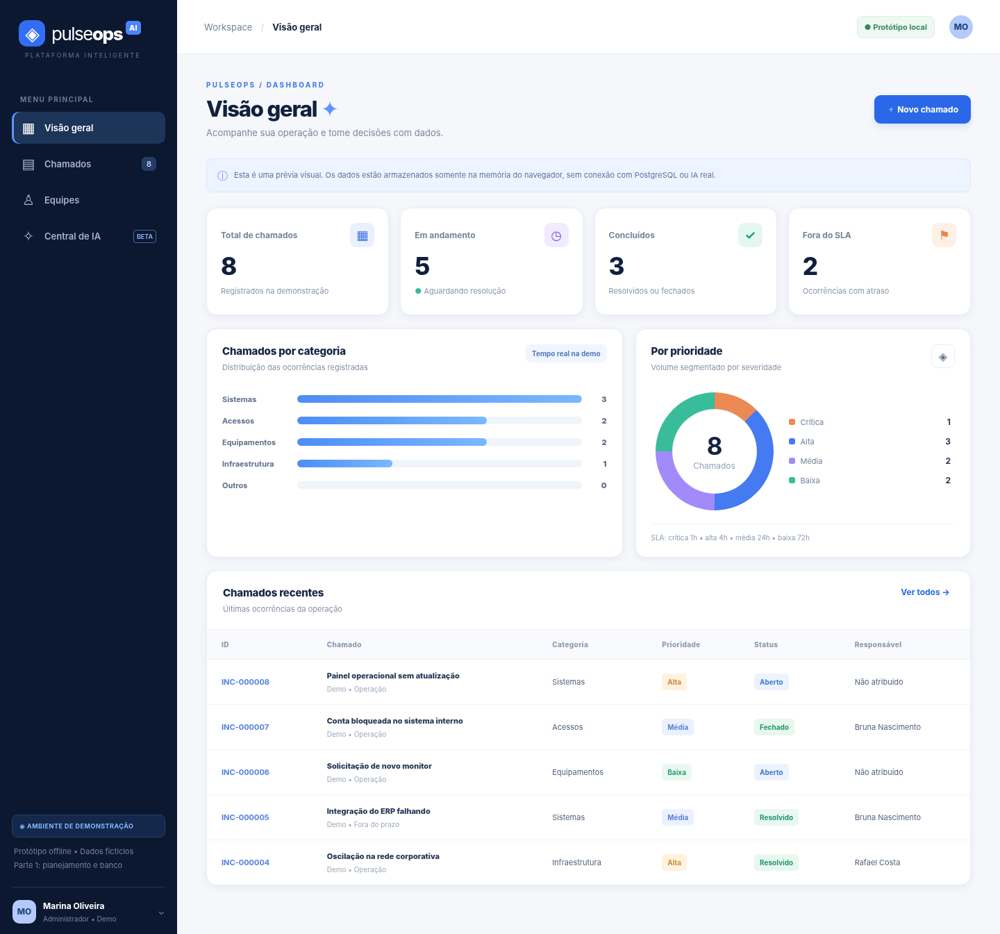
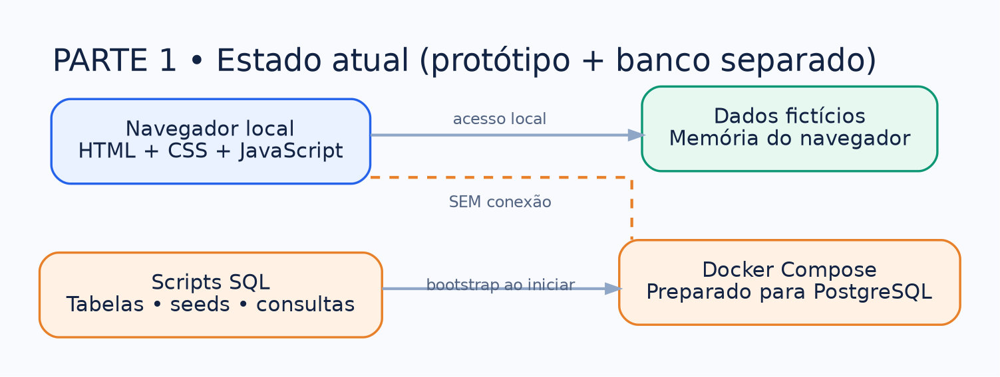
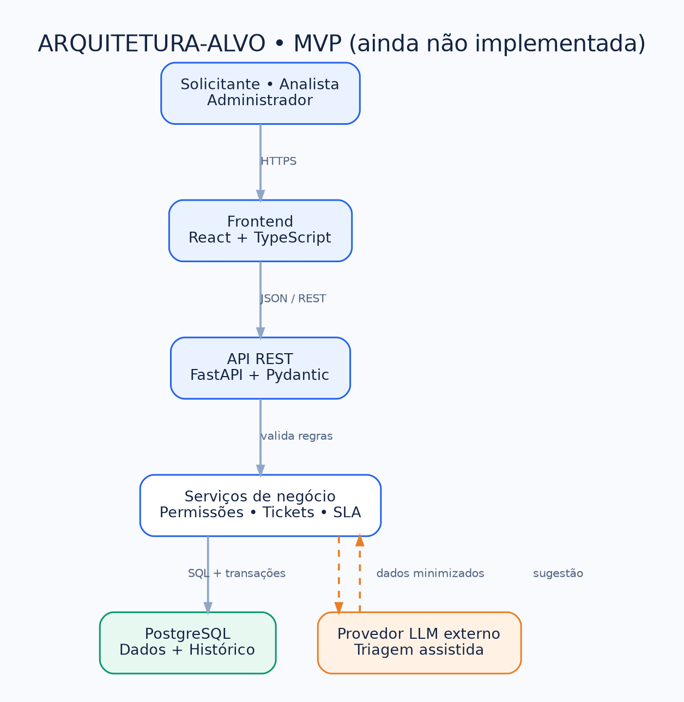
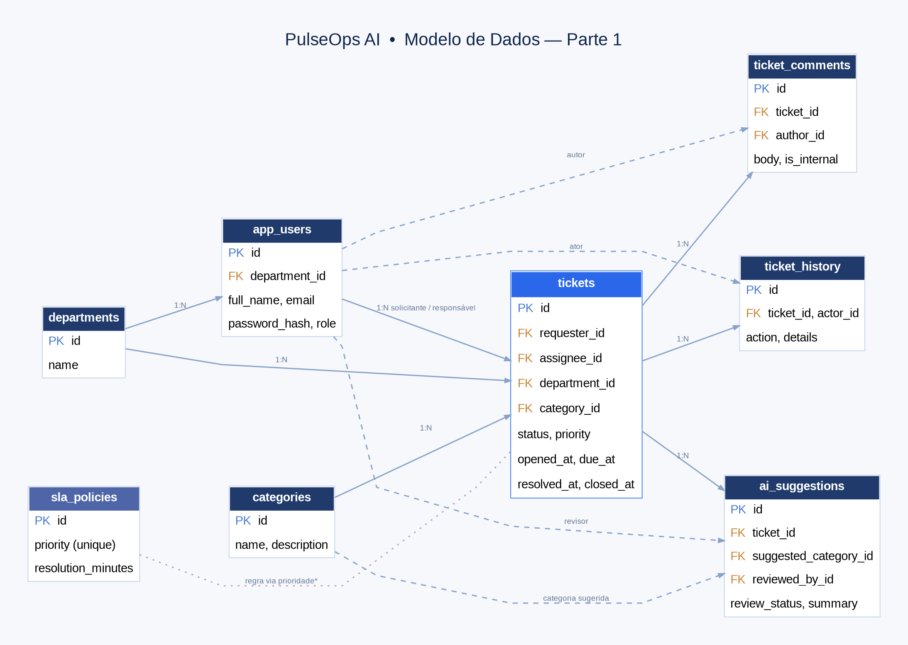
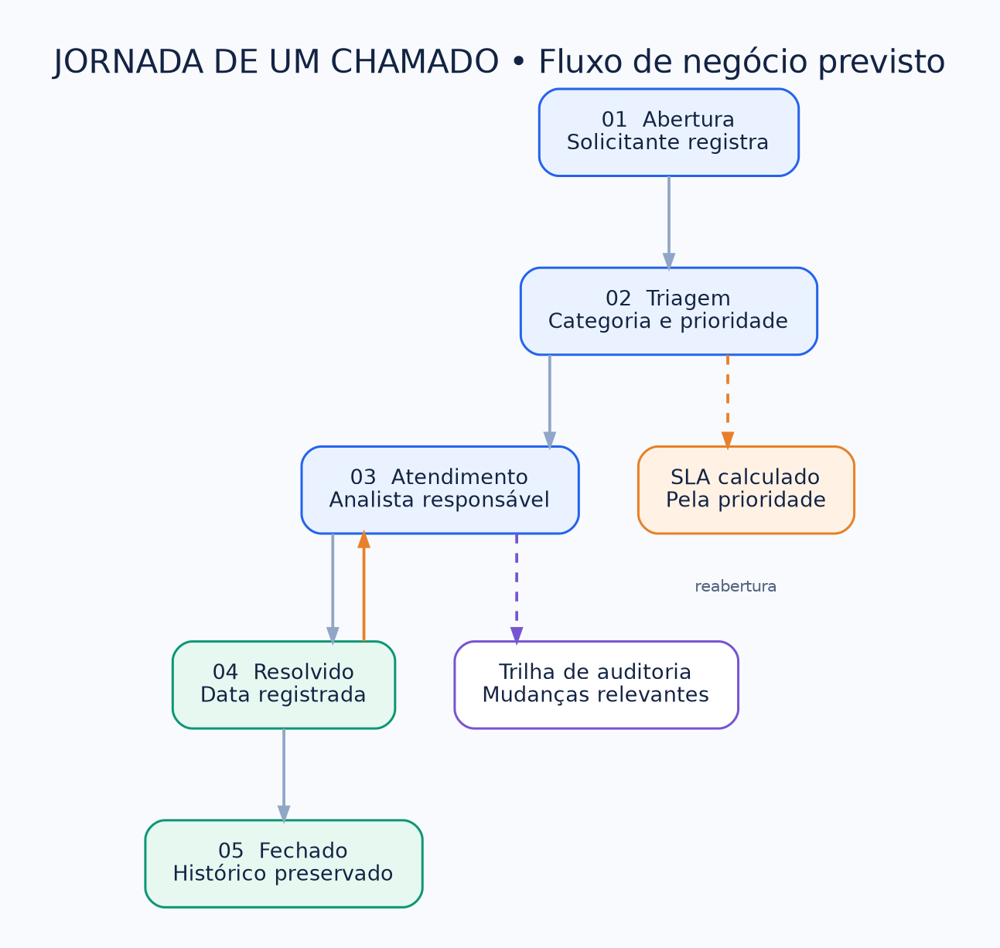
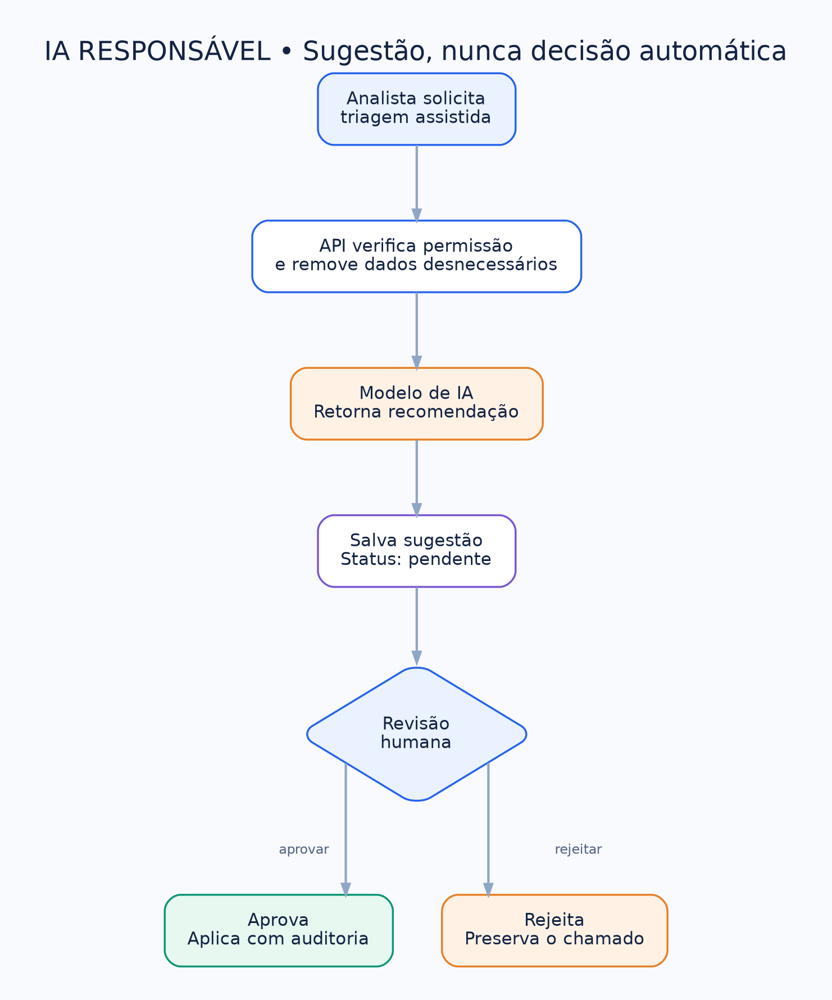
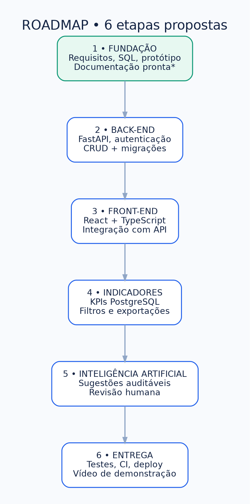
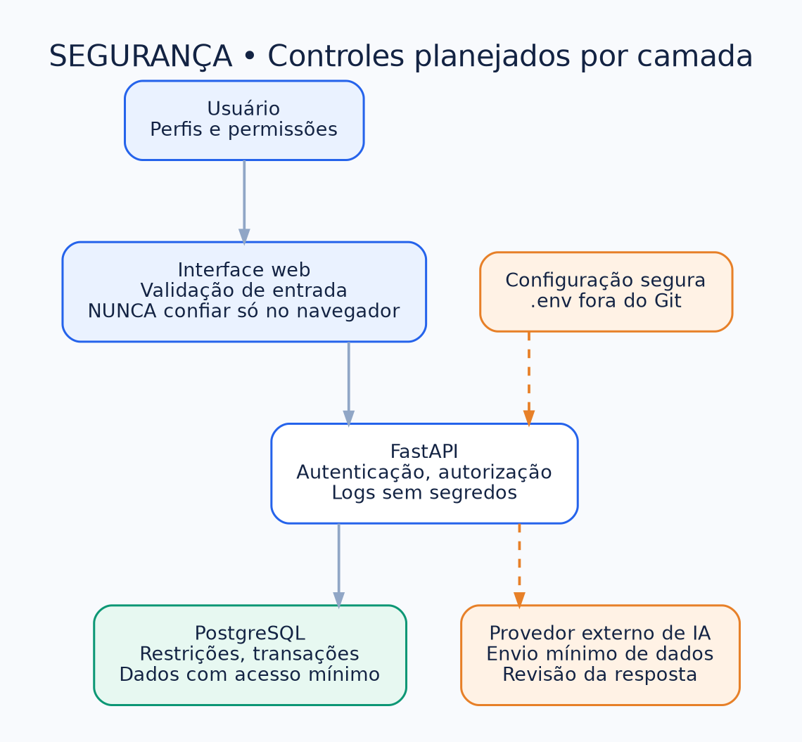
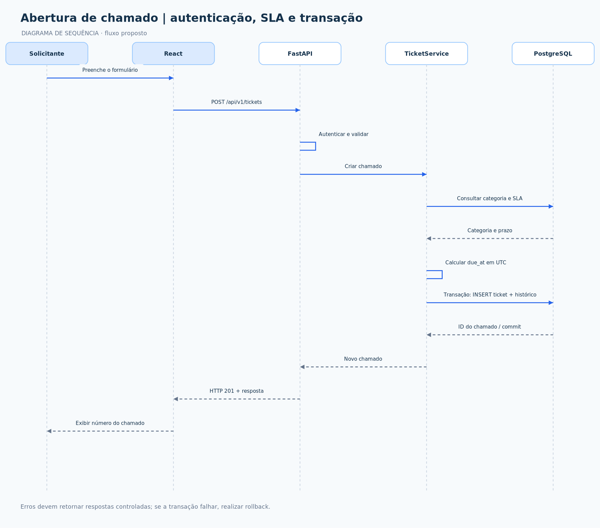
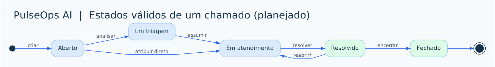

# Galeria visual — PulseOps AI

> **Objetivo:** tornar a documentação compreensível diretamente no GitHub. Diagramas mostram a arquitetura **planejada** quando indicado; não representam recursos já concluídos. Todas as figuras podem ser abertas em tamanho maior clicando nelas.

## 1. Interface demonstrativa existente (Parte 1)



**Status:** protótipo HTML/CSS/JavaScript funcional com dados fictícios em memória, sem autenticação e sem conexão com PostgreSQL. Fonte em [`../prototype/`](../../prototype).

## 2. Arquitetura realmente disponível agora



**Status:** código do protótipo disponível; Docker Compose e SQL preparados para validação local. [Fonte DOT](../imagens/01-arquitetura-atual.dot).

## 3. Arquitetura pretendida para o MVP



**Status:** planejado. Back-end, frontend React, autenticação e IA não existem nesta versão. [Fonte DOT](../imagens/02-arquitetura-alvo.dot) · [Arquitetura explicada](arquitetura.md).

## 4. Modelo relacional de dados



**Status:** esquema SQL preparado; validação de execução local pendente. [Fonte DOT](../banco-de-dados/diagramas/diagrama-entidades.dot) · [Fonte Mermaid](../banco-de-dados/diagramas/diagrama-er.mmd) · [SVG](../banco-de-dados/diagramas/diagrama-entidades.svg) · [Modelagem](../banco-de-dados/modelagem.md).

## 5. Fluxo de atendimento de chamados



**Status:** regra de negócio planejada para a API FastAPI. [Fonte DOT](../imagens/03-fluxo-chamado.dot) · [Regras](../requisitos/regras-de-negocio.md).

## 6. IA assistiva com decisão humana



**Status:** funcionalidade futura (Parte 5), sem IA ativa na Parte 1. [Fonte DOT](../imagens/04-ia-revisao-humana.dot).

## 7. Roadmap de implementação



**Status:** apenas a preparação documental da Parte 1 está concluída; teste do PostgreSQL no Docker permanece pendente. [Fonte DOT](../imagens/05-roadmap.dot) · [Sprints](../planejamento/roadmap-e-sprints.md).

## 8. Controles de segurança previstos



**Status:** metas de segurança para o back-end e a implantação. [Fonte DOT](../imagens/06-seguranca.dot) · [Plano de segurança](../seguranca/seguranca-e-privacidade.md).

---

### Como atualizar os diagramas

Os arquivos `.dot` na pasta `docs/imagens/` são as fontes editáveis. Com Graphviz instalado, gere PNG e SVG, por exemplo:

```powershell
dot -Tpng docs/imagens/02-arquitetura-alvo.dot -o docs/imagens/02-arquitetura-alvo.png
dot -Tsvg docs/imagens/02-arquitetura-alvo.dot -o docs/imagens/02-arquitetura-alvo.svg
```

Todos os links das imagens nos arquivos Markdown são **relativos**, por isso funcionam no GitHub quando as pastas são enviadas juntas. Se renomear uma figura, corrija as referências Markdown.

## 9. Modelagem UML com PlantUML

Agora também existem **sete modelos editáveis `.puml`** com prévias PNG e SVG: diagrama de casos de uso, classes, duas sequências, componentes, implantação e estados.





[Ver galeria completa de UML e os arquivos PlantUML](../uml/README.md). A renderização local oficial das fontes `.puml` pode ser feita com `scripts/renderizar-uml.ps1` após baixar o JAR PlantUML.
