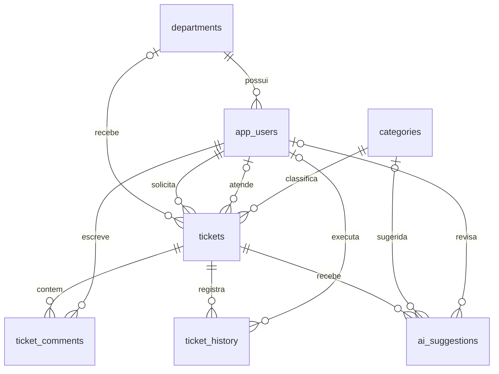

# Modelagem de dados

## Modelo conceitual (resumo)
- **Departamento** possui muitos usuários e muitos chamados.
- **Usuário** abre muitos chamados; um usuário analista pode ser responsável por muitos chamados.
- **Categoria** classifica muitos chamados.
- **Chamado** possui muitos comentários, registros de histórico e sugestões de IA.
- **Usuário** publica comentários, registra ações e aprova sugestões de IA.
- **Política de SLA** define prazo por prioridade (a correspondência com chamados é pela prioridade, aplicada pela API).

> O desenho editável `diagrama-er.mmd` representa o modelo lógico/físico com PK/FK e cardinalidades. O GitHub renderiza o diagrama Mermaid incluído abaixo.

## Modelo lógico — oito tabelas

**Fonte editável:** [Graphviz DOT](diagramas/diagrama-entidades.dot) · [Mermaid](diagramas/diagrama-er.mmd) · [SVG vetorial](diagramas/diagrama-entidades.svg).
| Tabela | Chave primária | Principais referências | Finalidade |
|---|---|---|---|
| `departments` | `id` | — | Setores organizacionais |
| `app_users` | `id` | `department_id → departments.id` | Contas e perfis |
| `categories` | `id` | — | Tipos de chamados |
| `sla_policies` | `id` | — | Prazo por prioridade |
| `tickets` | `id` | `requester_id`, `assignee_id → app_users.id`; `department_id`; `category_id` | Registros principais |
| `ticket_comments` | `id` | `ticket_id → tickets.id`; `author_id → app_users.id` | Conversas |
| `ticket_history` | `id` | `ticket_id → tickets.id`; `actor_id → app_users.id` | Trilha de auditoria do domínio |
| `ai_suggestions` | `id` | `ticket_id`; `suggested_category_id`; `reviewed_by_id` | Recomendações supervisionadas |

## Decisões de design
- Identificadores `BIGINT GENERATED ALWAYS AS IDENTITY` em vez de gerar IDs manualmente.
- Datas em `TIMESTAMPTZ`, evitando perda de fuso horário.
- Prioridade e status com restrições `CHECK` no banco. Lista pode migrar para tabelas de domínio futuramente.
- Exclusão de um chamado pode apagar comentários/histórico relacionados (`CASCADE`); na aplicação a estratégia recomendada é NÃO oferecer exclusão física de chamados em produção, para preservar auditoria.
- `app_users` em vez de `users` para indicar contas próprias da aplicação.
- Política de SLA normalizada em tabela separada, com `priority` única; API consulta tabela para definir o prazo do chamado.
- `v_ticket_sla` calcula a situação temporal; `v_dashboard_kpis` resume indicadores.
- `ai_suggestions` exige revisão humana para qualquer aprovação/rejeição registrada.
- Demo não fornece autenticação funcional; o hash fictício foi intencionalmente bloqueado.

## Dicionário resumido do chamado
- `title`, `description`: título e descrição de incidente.
- `requester_id`: autor do chamado (obrigatório).
- `assignee_id`: responsável técnico (opcional).
- `department_id`: setor (opcional).
- `category_id`: categoria (obrigatória).
- `status`: aberto, em_triagem, em_atendimento, resolvido, fechado.
- `priority`: baixa, media, alta, critica.
- `opened_at`, `due_at`, `resolved_at`, `closed_at`: ciclo de vida e SLA.

## SQL físico
Consultar `db/init/01_schema.sql` e `db/init/02_seed_demo.sql`.

## Modelo de classes UML

O [diagrama de classes em PlantUML](../uml/diagramas/02-classes-dominio.puml), com [imagem de prévia](../uml/imagens/02-classes-dominio.png), resume as oito entidades do modelo físico. Ele complementa o DER, mas a definição exata das FKs está em `db/init/01_schema.sql`. Veja [documentação UML](../uml/README.md).
