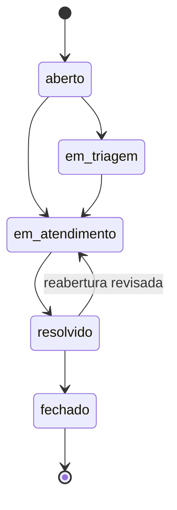

# Regras de negócio e fluxos do chamado

**Status:** contrato de negócio definido para implementação em FastAPI. Algumas restrições de consistência já estão no arquivo SQL; as regras de autorização e a maioria das transições dependerão da API.

## 1. Papéis e autorização

| Operação | Solicitante | Analista | Admin |
|---|---|---|---|
| Criar chamado | Sim | Sim | Sim |
| Visualizar chamado próprio | Sim | Sim | Sim |
| Visualizar chamados de outros | Não | Sim (fila autorizada) | Sim |
| Alterar status, prioridade ou responsável | Não | Sim | Sim |
| Comentar publicamente em chamado acessível | Sim | Sim | Sim |
| Ler/criar comentário interno | Não | Sim | Sim |
| Aprovar ou rejeitar sugestão da IA | Não | Sim | Sim |
| Alterar categorias e políticas de SLA | Não | Não | Sim |
| Consultar dashboard agregado | Não (MVP) | Sim | Sim |

Um solicitante só pode consultar seus próprios registros; um `404` genérico é apropriado para impedir descoberta de IDs não acessíveis. O servidor valida cada operação, mesmo que a UI esconda botões.

## 2. Campos obrigatórios

- `tickets.title`: até 180 caracteres, não vazio.
- `tickets.description`: texto não vazio, com limite de tamanho definido na API.
- `tickets.requester_id`: **extraído do token**, nunca aceito livremente de um usuário solicitante.
- `tickets.category_id`: categoria existente e ativa.
- `tickets.priority`: `baixa`, `media`, `alta`, `critica`; valor inicial `media` se omitido.
- `tickets.status`: inicial `aberto`.
- `tickets.assignee_id`: opcional e, quando informado, precisa representar usuário ativo com permissão de atendimento.

O SQL já exige os campos essenciais e restringe prioridade/status; validações de perfil, categoria ativa e tamanho máximo da descrição são **futuras**.

## 3. Estados e transições propostas

- **MVP recomendado:** transições acima; não mudar diretamente de `aberto` para `fechado`.
- Fechamento é terminal no MVP. Reabertura de um item fechado pode virar nova solicitação vinculada em versão futura.
- Ao entrar em `resolvido`, gravar `resolved_at`; em `fechado`, `closed_at`; ao reabrir, definir política explícita para novo tempo de resolução antes de implementar (há impacto sobre SLA e métricas).
- O banco existente garante que registros resolvidos tenham `resolved_at` e fechados tenham também `closed_at`, mas **não garante o grafo de transições**; isso caberá ao serviço e aos testes.

## 4. SLA (horas corridas no MVP)

| Prioridade | Minutos | Prazo ilustrativo |
|---|---:|---|
| `critica` | 60 | 1 hora |
| `alta` | 240 | 4 horas |
| `media` | 1.440 | 24 horas |
| `baixa` | 4.320 | 72 horas |

**Regra planejada:** `due_at = opened_at + resolution_minutes` da prioridade escolhida, comparando instantes com fuso. Para mudança de prioridade, recomendamos **recalcular sempre a partir do `opened_at`**, registrar os valores anterior/novo em `ticket_history` e nunca estender silenciosamente o prazo por atualizar a tarefa. Essa escolha precisa ser confirmada antes da API entrar em uso.

**Classificações:**

- `sem_prazo`: `due_at` vazio (legado/importação; não ideal para novos chamados).
- `em_dia`: não resolvido e agora ainda não passou de `due_at`.
- `atrasado`: não resolvido e `NOW() > due_at`.
- `dentro_do_prazo`: resolvido com `resolved_at <= due_at`.
- `fora_do_prazo`: resolvido com `resolved_at > due_at`.

Essas classificações já são expressas pela **view SQL preparada** `v_ticket_sla`, embora a validação de execução no Docker esteja pendente.

## 5. Comentários e histórico

- Comentários têm autor, chamado, conteúdo, data e flag `is_internal`.
- Comentários internos jamais aparecem nas respostas para solicitantes.
- A cada criação ou alteração relevante: emitir um evento em `ticket_history` com `action`, ator, antes/depois e data.
- Histórico operacional deve ser tratado como imutável na API; não oferecer edição ou exclusão por endpoints públicos.
- **Atenção:** no SQL inicial, relacionamentos com chamados em comentários/histórico usam `ON DELETE CASCADE`. Por preservação de trilha, o produto não deverá disponibilizar exclusão física de chamados; rever esse desenho antes de um ambiente de produção.

## 6. Revisão de IA

1. O analista solicita uma sugestão; o backend elimina informações desnecessárias e envia uma entrada limitada ao provedor.
2. A resposta é validada contra categorias/prioridades existentes e salva em `ai_suggestions` com `review_status='pendente'`.
3. A IA **não** altera o chamado automaticamente.
4. Analista/admin aprova ou rejeita, identificando `reviewed_by_id` e `reviewed_at`.
5. Ao aprovar, o serviço poderá aplicar a categoria/prioridade validada dentro de transação e registrar a decisão humana no histórico.
6. Erro, timeout ou retorno inválido do modelo não pode impedir triagem manual.

## 7. Exemplos de aceite

- Um solicitante autenticado não consegue abrir um ticket com `requester_id` de outra pessoa.
- Um solicitante não vê comentários marcados como internos.
- Uma prioridade `urgente` (fora do domínio) deve ser rejeitada.
- Resolver um ticket grava `resolved_at` e evento de histórico atomicamente.
- Recomendação de IA `pendente` não modifica `tickets.priority`.
- Ticket criado com prioridade `alta` deve ter prazo calculado em 240 minutos corridos.

## Diagramas UML complementares

O fluxo de estados está disponível como [PlantUML editável](../uml/diagramas/07-estados-chamado.puml) e com [prévia PNG](../uml/imagens/07-estados-chamado.png). A [sequência de triagem com IA](../uml/diagramas/04-sequencia-triagem-ia.puml) torna explícita a revisão humana obrigatória. Confira o [guia UML](../uml/README.md).
