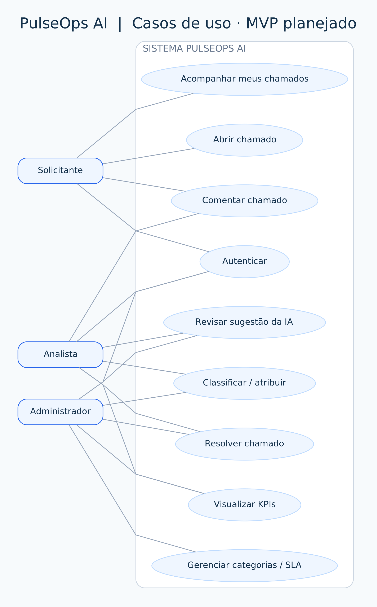
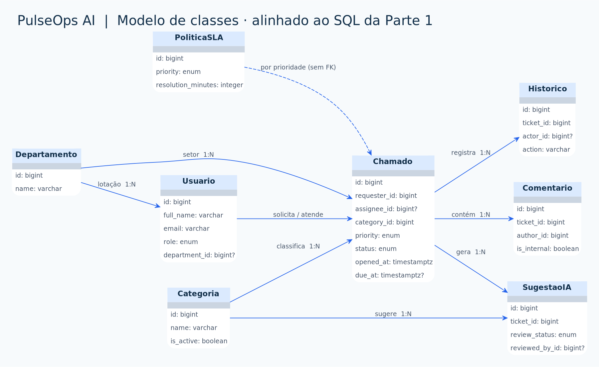
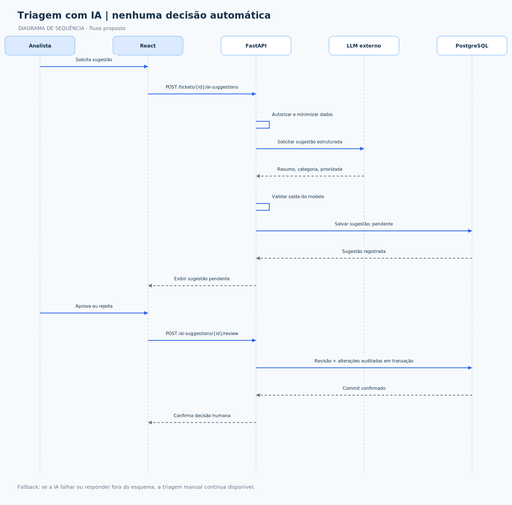
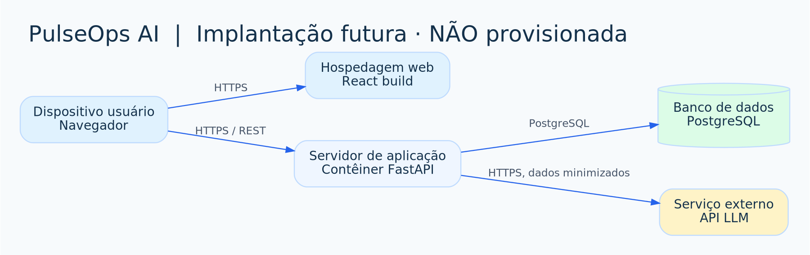

# Diagramas UML com PlantUML — PulseOps AI

> **Estado da documentação:** Diagramas representam a especificação desejada, não classes de código ou serviços já implementados. As imagens são prévias; a renderização oficial pelo PlantUML pode ser feita localmente.

> **Status:** especificação para o MVP; a Parte 1 entrega o protótipo HTML/CSS/JS e os scripts SQL, **não** uma API, front-end React ou IA integrados. Os arquivos `.puml` são fontes editáveis. As prévias SVG/PNG incluídas representam os mesmos fluxos, mas foram desenhadas por ferramentas locais de visualização, **não exportadas por um motor PlantUML** nesta entrega. Depois de instalar o PlantUML, use `scripts/renderizar-uml.ps1` para substituir as prévias por imagens geradas diretamente das fontes.

## Diagramas disponíveis

| Tipo UML | Para que serve | Código editável |
|---|---|---|
| Casos de uso | Funções visíveis para solicitante, analista e administrador | [`01-casos-de-uso.puml`](diagramas/01-casos-de-uso.puml) |
| Classes | Domínio e cardinalidades que refletem as 8 tabelas SQL | [`02-classes-dominio.puml`](diagramas/02-classes-dominio.puml) |
| Sequência — abrir chamado | Autenticação, SLA e gravação atômica do chamado com histórico | [`03-sequencia-criar-chamado.puml`](diagramas/03-sequencia-criar-chamado.puml) |
| Sequência — IA | Triagem supervisionada, validação e aprovação/rejeição por pessoa | [`04-sequencia-triagem-ia.puml`](diagramas/04-sequencia-triagem-ia.puml) |
| Componentes | Fronteiras React, FastAPI, ORM, PostgreSQL e LLM externo | [`05-componentes.puml`](diagramas/05-componentes.puml) |
| Implantação | Topologia proposta para hospedagem futura | [`06-implantacao.puml`](diagramas/06-implantacao.puml) |
| Estados | Transições permitidas para um chamado | [`07-estados-chamado.puml`](diagramas/07-estados-chamado.puml) |

## 1. Casos de uso



As permissões definitivas serão aplicadas pelo **back-end**. Detalhes em [regras de negócio](../requisitos/regras-de-negocio.md).

## 2. Classes de domínio



O diagrama é um **modelo de domínio** alinhado às tabelas do arquivo [`01_schema.sql`](../../db/init/01_schema.sql), não afirma a existência de classes ORM implementadas. `sla_policies` é buscada pela prioridade, **sem chave estrangeira direta em `tickets`**. Para FKs exatas, consulte o [modelo físico](../banco-de-dados/modelagem.md).

## 3. Sequência de abertura de chamado


**Plano para Parte 2:** extrair `requester_id` da credencial; validar categoria e SLA; inserir ticket e histórico **na mesma transação**; retornar `201` ou erro controlado. A versão `.puml` contém os caminhos alternativos de erro que não cabem completamente na prévia resumida.

## 4. Sequência de triagem com IA



**Plano para Parte 5:** enviar somente dados minimizados; validar saída; salvar sugestão como `pendente`; uma pessoa aprova ou rejeita. **Nenhum campo do chamado deve mudar apenas porque a IA sugeriu algo.** Em falhas, manter triagem manual.

## 5. Componentes


A API será um **monólito modular**; não há necessidade de microsserviços para o MVP.

## 6. Implantação



A topologia é uma proposta. **Não indica hospedagem nem deploy existentes.** Por enquanto o Docker Compose prepara o PostgreSQL para desenvolvimento local.

## 7. Estados do chamado


A passagem `resolvido → em_atendimento` depende da decisão sobre recalcular prazos de SLA em reaberturas. A API terá de bloquear transições inválidas; o esquema SQL isolado não garante todas as transições.

## Como editar e renderizar no VS Code (Windows)

1. Abra qualquer arquivo `.puml` da pasta `docs/uml/diagramas/` com o VS Code. Instale a extensão **PlantUML** de jebbs se desejar pré-visualização no editor.
2. Tenha **Java** instalado (e **Graphviz** quando o PlantUML exigir para certos diagramas) e obtenha o arquivo `.jar` de uma distribuição oficial do [PlantUML](https://plantuml.com/download). Coloque-o localmente em `tools/plantuml.jar` (essa pasta pode ser criada; o JAR **não está incluído** no ZIP).
3. No PowerShell, na raiz do projeto, execute:

```powershell
.\scripts\renderizar-uml.ps1
```

O script produzirá SVG e PNG em `docs/uml/imagens/` a partir dos arquivos PlantUML; adicione as imagens ao commit junto com as fontes editáveis. Ele exige Java e o JAR PlantUML. Alternativamente, use a opção de exportação da extensão no VS Code.

> Não é necessário enviar suas descrições de chamados para servidores públicos de renderização. A renderização local preserva o conteúdo no computador.

## Manutenção e revisão

- Atualize o `.puml` **no mesmo commit** em que implementar uma mudança relevante de fluxo ou modelo.
- Depois de gerar as imagens, confira se o Markdown ainda aponta para o arquivo correto.
- Não trate a modelagem projetada como funcionalidade concluída: atualize o status quando os testes passarem.
- **Fonte da verdade dos dados:** `db/init/01_schema.sql`. **Fonte das regras propostas:** `docs/requisitos/regras-de-negocio.md`.
